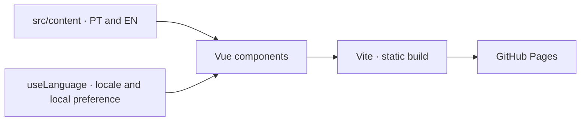

# Camila Teixeira's portfolio

[Português](README.md) · **English** · [Open the portfolio](https://acamilateixeira.github.io/camilat/)

[](https://github.com/acamilateixeira/camilat/actions/workflows/ci.yml)

A software engineering portfolio focused on back-end and full-stack work. Each case study explains the need behind the project, what was built, and why the technical decisions made sense.

## What each project demonstrates

| Project | Problem and design decision |
| --- | --- |
| [TripFlow](https://github.com/acamilateixeira/tripflow) | A Laravel corporate travel API. Locks protect the budget, idempotency handles retries, and an outbox publishes events after commit. The demo uses a simulated supplier. |
| [Bora](https://github.com/acamilateixeira/Bora) | An app requested by the municipality of Conceição do Mato Dentro, Brazil. It tracks rides per driver, contact details, and department-level access. Operational membership is separate from availability. |
| [Livit Live Controller](https://acamilateixeira.github.io/camilat/#livit-live-controller) | A local TikTok LIVE controller built for an 8 GB Mac. It separates preview from broadcast output and includes a shared game engine, a music queue extension, and adaptive rendering. The case study is public and the source code is private. |
| [Sorteador](https://github.com/acamilateixeira/sorteador-web) · [demo](https://acamilateixeira.github.io/sorteador-web/) | A browser-only name and number draw built with Angular 22. Reactive Forms and signals in the UI, Web Crypto without modulo bias in the engine, and tests and deployment on GitHub Actions. |

## Selection and review criteria

1. **Start with the problem.** Explain who needed the project and what made the work difficult.
2. **Connect design decisions to their effects.** Explain what each choice solves and under what conditions. List technologies after the context.
3. **Check what can be demonstrated.** Review code, tests, or documentation before describing a capability as implemented. Label demos, prototypes, simulated integrations, and diagrams.
4. **Review Portuguese and English together.** Update both languages in the same change. Check links, lint, types, tests, and the build before publishing.

## Portfolio architecture



| Technology | Role |
| --- | --- |
| **Vue 3 and TypeScript** | Section components and types that require copy in both languages. |
| **Vite** | Local development server and static build under `/camilat/`. |
| **Vitest and Vue Test Utils** | Tests for navigation, language selection, links, and content parity. |
| **ESLint and GitHub Actions** | Pull request checks, a JavaScript size budget, and GitHub Pages deployment. |

Copy lives in [`src/content/`](src/content). Components in [`src/components/`](src/components) handle presentation. [`useLanguage`](src/composables/useLanguage.ts) detects the locale, sets the `lang` attribute, and saves the preference when local storage is available.

## Run and verify

Use Node.js 22 and npm.

```bash
git clone https://github.com/acamilateixeira/camilat.git
cd camilat
npm install
npm run dev
```

Open the URL printed by Vite. To verify a change:

```bash
npm run lint
npm run typecheck
npm test
npm run build
```

CI checks that the generated JavaScript stays below 150 KiB. Pull request validation checks the title and description. Optional AI review requires `ANTHROPIC_API_KEY`. Deployment runs after changes reach `main`, with **GitHub Actions** configured as the Pages source. [Workflows](.github/workflows)
