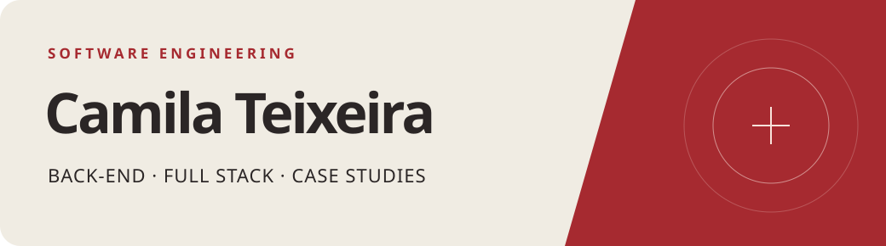
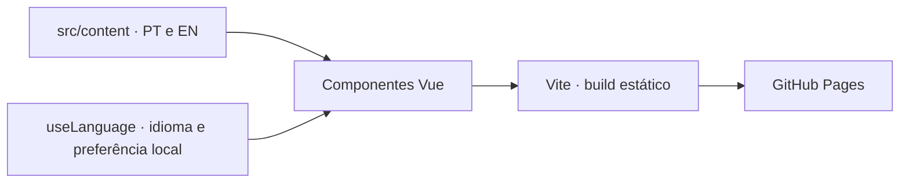

# Portfólio de Camila Teixeira

**Português** · [English](README.en.md) · [Abrir portfólio](https://acamilateixeira.github.io/camilat/)

[](https://github.com/acamilateixeira/camilat/actions/workflows/ci.yml)

Portfólio de engenharia de software com foco em back-end e desenvolvimento full stack. Cada estudo de caso apresenta a necessidade que deu origem ao projeto, o que foi implementado e as razões para as escolhas técnicas.

## O que cada caso demonstra

| Projeto | Problema e decisão em destaque |
| --- | --- |
| [GEMP](https://github.com/acamilateixeira/GEMP) | Comparador de crédito fictício em Go, React e TypeScript. Consulta três provedores em paralelo com prazo individual, mantém as ofertas válidas quando um falha e ordena pelo custo total. |
| [TripFlow](https://github.com/acamilateixeira/tripflow) | API Laravel de viagens corporativas. Locks para proteger o orçamento, idempotência para reenvios e outbox para publicar eventos após o commit. A demo usa fornecedor simulado. |
| [Bora](https://github.com/acamilateixeira/Bora) | App criado a pedido da Prefeitura de Conceição do Mato Dentro (MG). Histórico de corridas por motorista, contato e acesso por órgão. O vínculo operacional é tratado separadamente da disponibilidade. |
| [Livit Live Controller](https://acamilateixeira.github.io/camilat/#livit-live-controller) | Controlador local de TikTok LIVE para um Mac de 8 GB. Prévia separada da saída, motor compartilhado de jogos, extensão de fila musical e renderização adaptativa. O caso é público e o código é privado. |
| [Sorteador](https://github.com/acamilateixeira/sorteador-web) · [demo](https://acamilateixeira.github.io/sorteador-web/) | Sorteio auditável em Angular 22: compromisso SHA-256 antes do sorteio, contribuição pública na semente e comprovante verificável por link. 18 testes, incluindo vetor fixo e adulterações, rodam no GitHub Actions. |

## Critérios de seleção e revisão

1. **Começar pelo problema.** Explicar quem precisava da solução e o que dificultava a operação.
2. **Relacionar a arquitetura ao efeito.** Cada decisão precisa explicar o que resolveu e em que condições funciona. Uma lista de tecnologias serve como referência, depois do contexto.
3. **Conferir o que pode ser demonstrado.** Revisar código, testes ou guias antes de apresentar um recurso como implementado. Identificar demos, protótipos, integrações simuladas e diagramas.
4. **Revisar PT e EN juntos.** A mesma mudança atualiza os dois idiomas. Antes de publicar, conferir os links e rodar lint, tipos, testes e build.

## Arquitetura do portfólio



| Tecnologia | Papel |
| --- | --- |
| **Vue 3 e TypeScript** | Componentes por seção e tipos que exigem textos nos dois idiomas. |
| **Vite** | Servidor local e build estático sob `/camilat/`. |
| **Vitest e Vue Test Utils** | Testes de navegação, seleção de idioma, links e paridade de conteúdo. |
| **ESLint e GitHub Actions** | Verificações em PRs, orçamento de JavaScript e publicação no GitHub Pages. |

O conteúdo fica em [`src/content/`](src/content). Os componentes em [`src/components/`](src/components) cuidam da apresentação. [`useLanguage`](src/composables/useLanguage.ts) detecta o idioma, aplica o atributo `lang` e guarda a preferência quando o armazenamento local está disponível.

## Rodar e verificar

Use Node.js 22 e npm.

```bash
git clone https://github.com/acamilateixeira/camilat.git
cd camilat
npm install
npm run dev
```

Abra a URL exibida pelo Vite. Para conferir uma alteração:

```bash
npm run lint
npm run typecheck
npm test
npm run build
```

O CI verifica que o JavaScript gerado fica abaixo de 150 KiB. A validação de PR confere título e descrição. A revisão por IA é opcional e depende de `ANTHROPIC_API_KEY`. O deploy roda após mudanças na `main`, com **GitHub Actions** configurado como fonte do Pages. [Workflows](.github/workflows)
